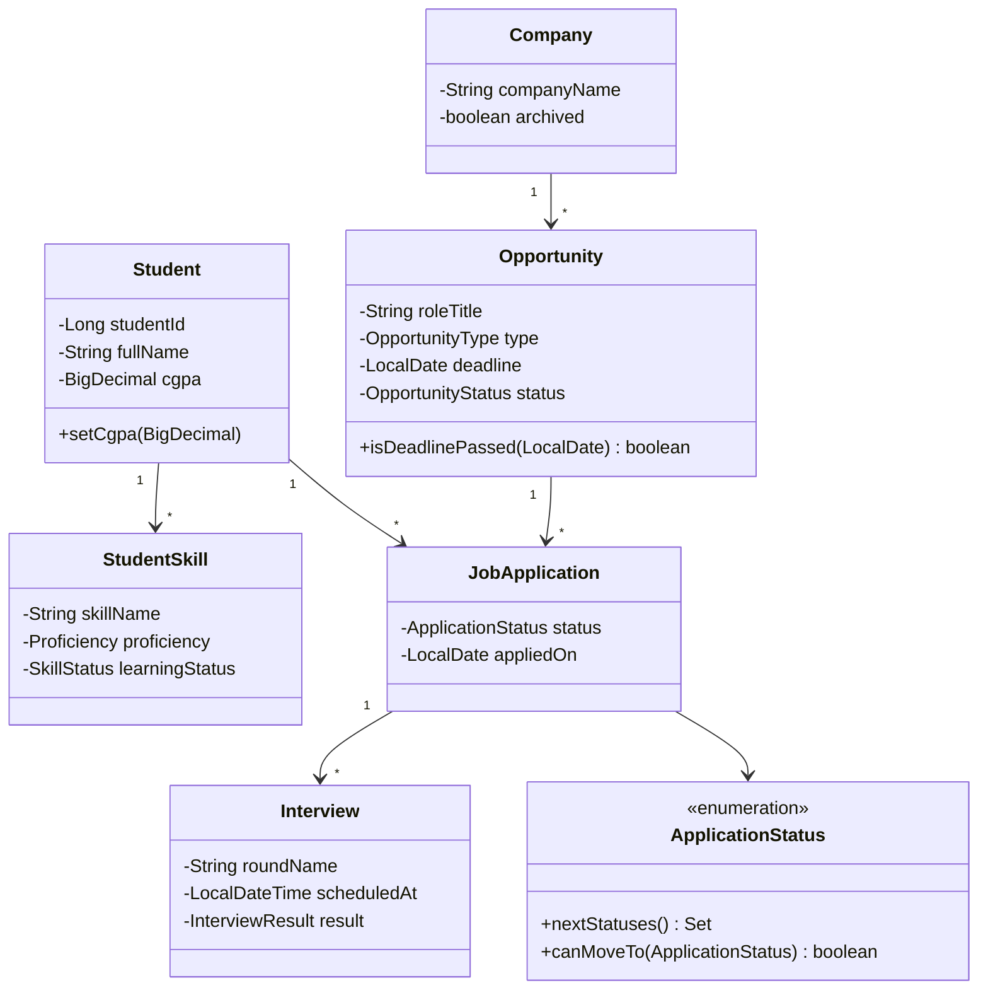
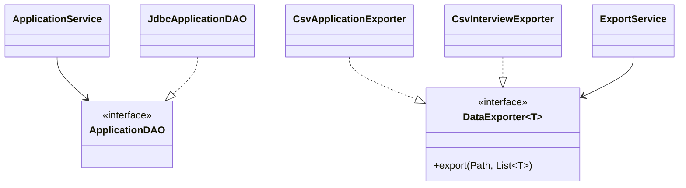

# Class design

## Layers and collaborators

The JavaFX controllers in `fx.controller` call the services and know nothing about DAOs or SQL.

Services depend on DAO interfaces, never on JDBC classes, which is what lets the tests run against in-memory implementations. `ExportService` is written against `DataExporter`, so another format needs only a new implementation.
