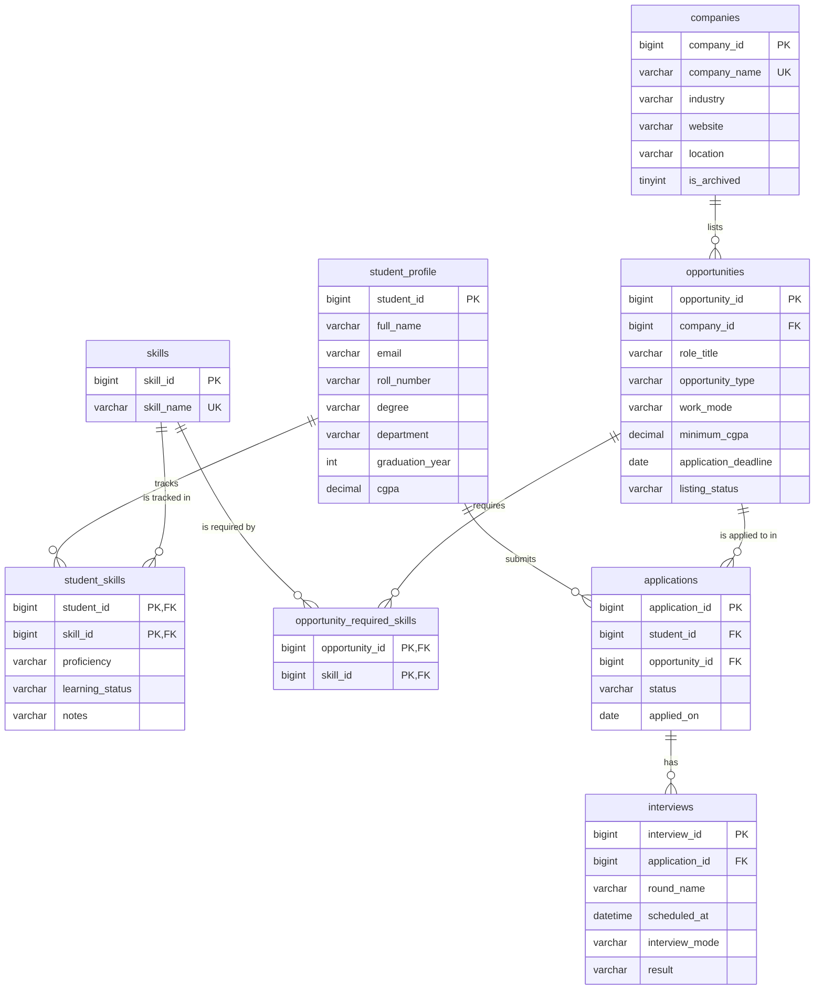

# Database design

Database: `student_placement_tracker` (MySQL). The full DDL is in [`database/schema.sql`](../database/schema.sql).

## Integrity rules

- `applications` has a unique key on `(student_id, opportunity_id)`, so the same opportunity cannot be applied to twice. The service checks first and the database enforces it.
- `student_skills` has a composite primary key on `(student_id, skill_id)`.
- `companies.company_name` is unique.
- Status and type columns are guarded by `CHECK` constraints that mirror the Java enums.
- Deleting an interview-bearing application cascades to its interviews. Companies and opportunities are archived rather than deleted, and foreign keys without a cascade stop accidental removal.
